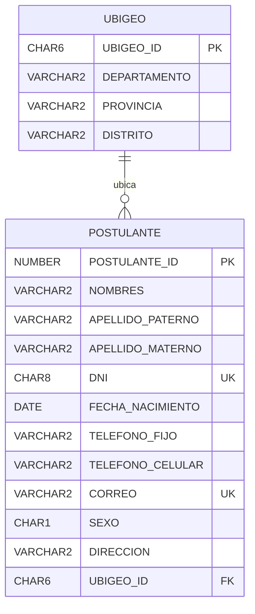

<div align="center">

# Candidate Management Desktop

Aplicación de escritorio para gestionar postulantes: registro, actualización, eliminación, listado y búsqueda, con validación de datos y ubicación geográfica por ubigeo.


</div>

## Funcionalidades

- Registro, actualización, eliminación y listado de postulantes.
- Búsqueda por nombres, apellido paterno o apellido materno.
- Operaciones de registro, actualización y búsqueda mediante procedimientos almacenados.
- Validación de nombres, DNI, correo electrónico, teléfonos y sexo, con aviso de DNI o correo ya registrados.
- Selección de departamento, provincia y distrito desde el catálogo de ubigeo del INEI, con búsqueda por código o por nombre de distrito.

## Tecnologías

| Tecnología | Uso |
|---|---|
| Java | Lenguaje de la aplicación |
| Swing | Interfaz gráfica de escritorio |
| JDBC (`ojdbc`) | Acceso a datos con `PreparedStatement` y `CallableStatement` |
| Oracle Database | Persistencia, restricciones y procedimientos almacenados (PL/SQL) |

## Base de datos

Modelo:



Los scripts están en [`database/`](database) y se ejecutan en orden con el usuario dueño del esquema:

| Script | Contenido |
|---|---|
| [`01-schema.sql`](database/01-schema.sql) | Tablas `UBIGEO` y `POSTULANTE`, restricciones y secuencia `SEQ_POSTULANTE` |
| [`02-pkg-postulante.sql`](database/02-pkg-postulante.sql) | Paquete `PKG_POSTULANTE` con `SP_INSERTAR`, `SP_ACTUALIZAR` y `SP_BUSCAR` |
| [`03-seed.sql`](database/03-seed.sql) | Ubigeos y postulantes de prueba |

## Estructura

```
candidate-management-desktop/
├── database/        scripts SQL de Oracle
└── README.md
```

## Avance

| Módulo | Estado |
|---|---|
| Base de datos y procedimientos almacenados | ✅ |
| Capa de persistencia (JDBC) | ⏳ |
| Validaciones | ⏳ |
| Carga y búsqueda de ubigeo | ⏳ |
| Interfaz Swing | ⏳ |

## Autor

**Jairo Alejandro Castañeda Pedraza**
