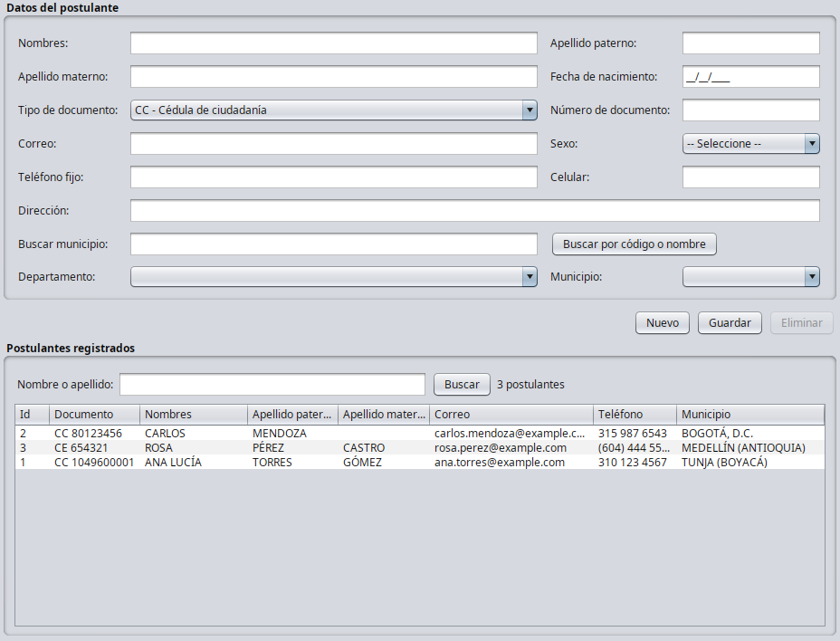
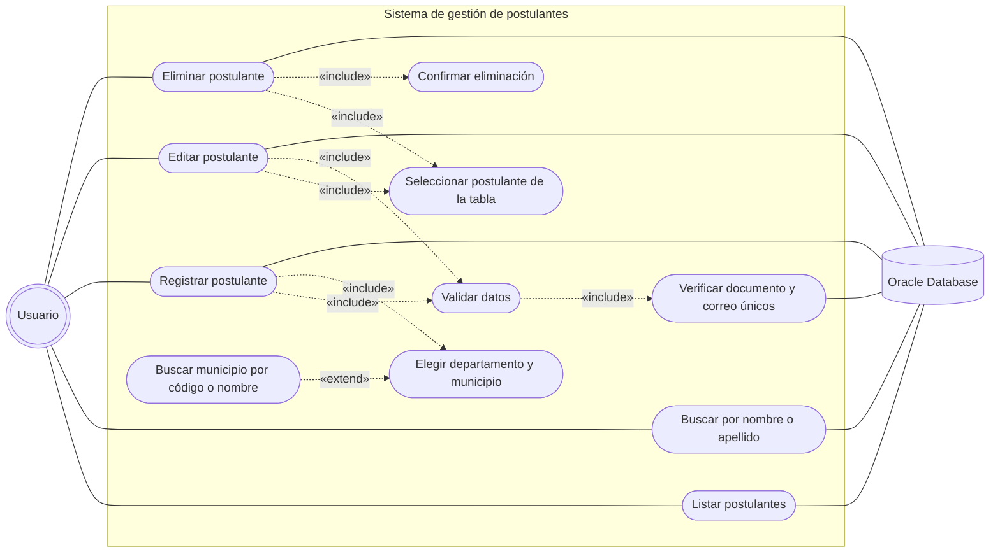
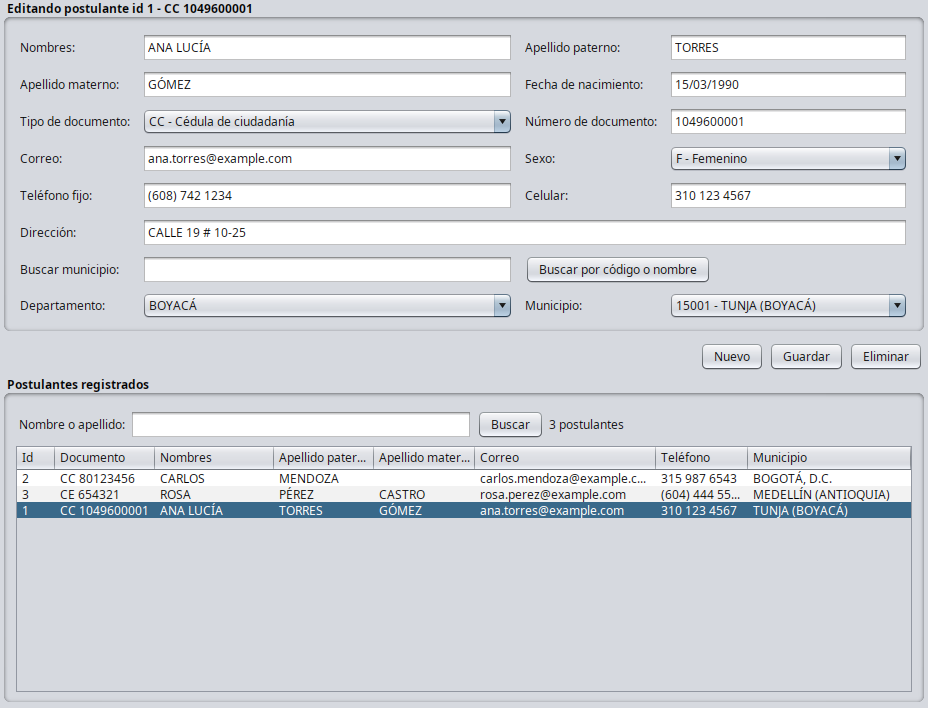
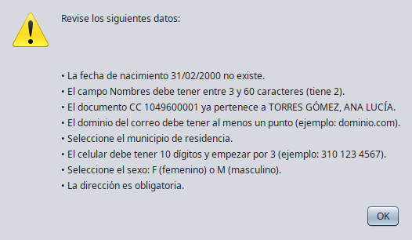
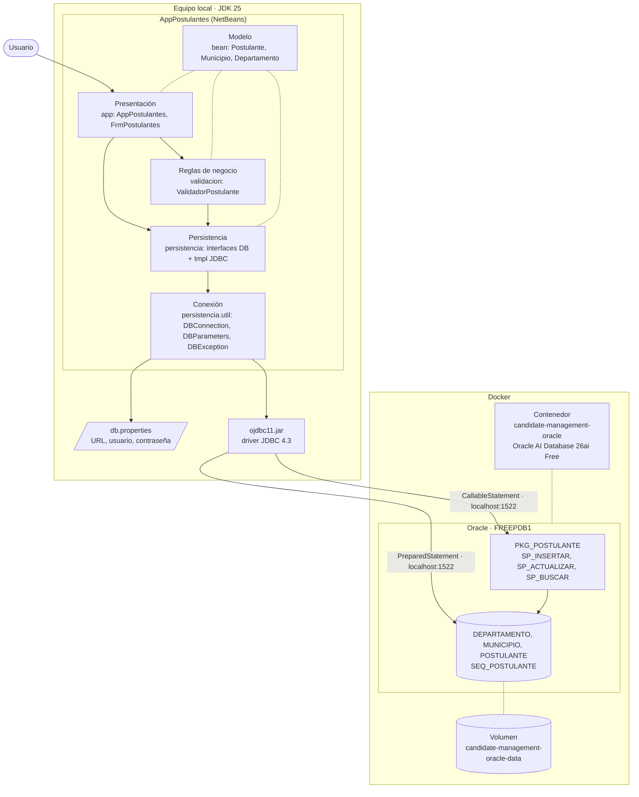
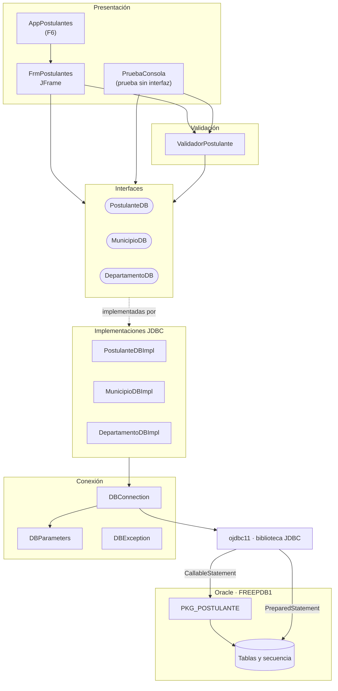
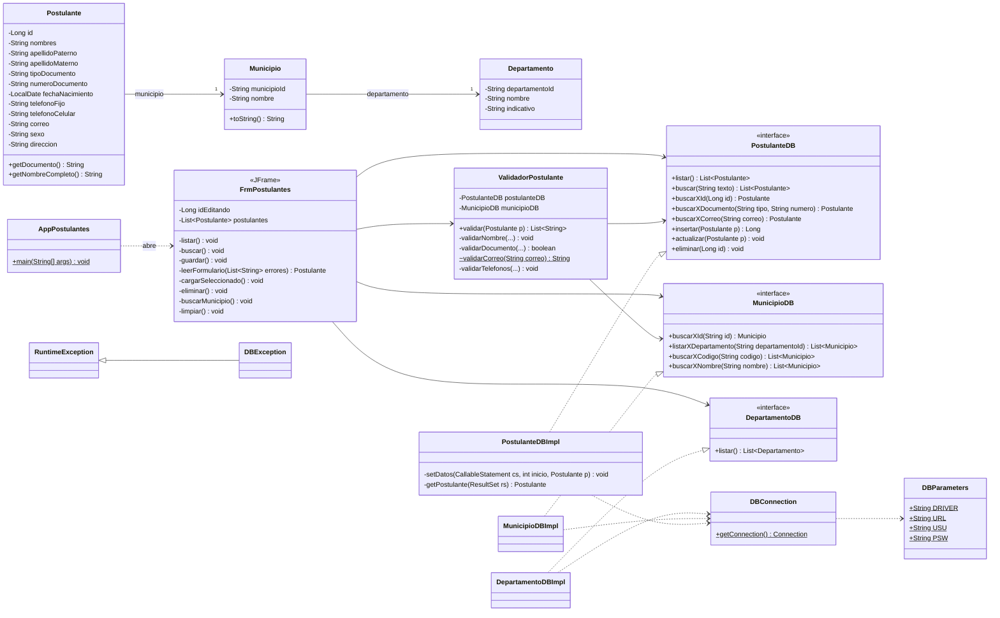
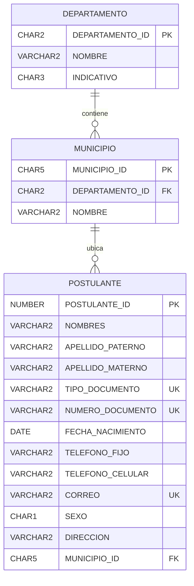

<div align="center">

# Candidate Management Desktop

Aplicación de escritorio para gestionar postulantes: registro, actualización, eliminación, listado y búsqueda, con validación de datos para Colombia y ubicación por departamento y municipio (DIVIPOLA del DANE).


</div>



## Funcionalidades

- Registro, actualización, eliminación y listado de postulantes.
- Búsqueda por nombres, apellido paterno o apellido materno, sin distinguir mayúsculas ni tildes.
- Operaciones de registro, actualización y búsqueda mediante procedimientos almacenados.
- Documento de identidad colombiano por tipo y número: cédula de ciudadanía (CC), tarjeta de identidad (TI), cédula de extranjería (CE), pasaporte (PA) y permiso por protección temporal (PPT).
- Validación de nombres, documento, correo electrónico, teléfonos y sexo, con aviso de documento o correo ya registrados.
- Teléfonos con el formato colombiano: celular de 10 dígitos y fijo con el indicativo regional (601 a 608).
- Selección de departamento y municipio desde el catálogo DIVIPOLA del DANE, con búsqueda por código o por nombre de municipio.

### Reglas de validación

Antes de registrar o actualizar, `ValidadorPostulante` quita espacios sobrantes, pasa los textos a mayúsculas y devuelve todos los errores juntos.

| Dato | Regla |
|---|---|
| Nombres y apellidos | Entre 3 y 60 caracteres; solo letras, espacios y apóstrofo. El apellido materno es opcional. |
| Documento | CC de 6 a 10 dígitos, TI de 10 a 11, CE de 6 a 7, PPT de 6 a 8 y PA de 5 a 9 letras o números. No se repite: el mensaje indica a quién pertenece. |
| Correo | Validado sin expresiones regulares: una sola `@`, usuario y dominio válidos y extensión de al menos 2 letras. No se repite. |
| Teléfonos | Al menos uno; solo dígitos, espacios, `-` y `()`. Celular de 10 dígitos que empieza por 3; fijo de 10 dígitos con el indicativo del departamento del municipio. |
| Sexo | F o M. |

## Casos de uso

El usuario de la aplicación (por ejemplo, quien registra a los postulantes en un proceso de selección) trabaja desde un único formulario. La base de datos Oracle participa como actor secundario: ejecuta los procedimientos almacenados y garantiza las restricciones.



| Caso de uso | Cómo se resuelve | Rúbrica |
|---|---|---|
| Listar postulantes | Al abrir el formulario: `PostulanteDB.listar()` con `PreparedStatement` | CRUD |
| Buscar por nombre o apellido | `SP_BUSCAR` devuelve un `SYS_REFCURSOR`; sin mayúsculas ni tildes | Búsqueda + SP |
| Registrar postulante | Validación y luego `SP_INSERTAR`, que devuelve el id generado | CRUD + SP |
| Editar postulante | Selección en la tabla, validación y `SP_ACTUALIZAR` | CRUD + SP |
| Eliminar postulante | Selección, confirmación y `DELETE` | CRUD |
| Validar datos | `ValidadorPostulante`: nombres, documento, correo sin regex, teléfonos y sexo | 5 validaciones |
| Verificar documento y correo únicos | Consulta a la base; el mensaje indica a quién pertenece el dato | Validaciones |
| Elegir departamento y municipio | Combos en cascada con los 1.122 municipios de la DIVIPOLA | Ubicación |
| Buscar municipio por código o nombre | `buscarXCodigo` o `buscarXNombre` según lo escrito; opcional al elegir municipio | Ubicación |

«include»: el caso siempre incluye al otro (no se registra sin validar). «extend»: el caso puede ampliarse con el otro de forma opcional (el municipio se elige en los combos o, si se prefiere, buscándolo).

## Uso del formulario

| Acción | Cómo |
|---|---|
| Registrar | Llenar los datos y pulsar **Guardar**. Si algo no es válido, aparecen todos los errores juntos y no se guarda nada. |
| Buscar | Escribir parte del nombre o de un apellido y pulsar **Buscar** o Enter (sin tildes ni mayúsculas). Vacío muestra todos. |
| Editar | Seleccionar la fila en la tabla: sus datos pasan al formulario. Cambiar lo necesario y pulsar **Guardar**. |
| Eliminar | Seleccionar la fila y pulsar **Eliminar**; pide confirmación. |
| Municipio | Elegir el departamento y luego el municipio, o escribir un código DIVIPOLA (`15001`) o parte del nombre (`tunja`) y pulsar **Buscar por código o nombre**. |
| Empezar de nuevo | **Nuevo** limpia el formulario. |

<table>
  <tr>
    <td></td>
    <td></td>
  </tr>
  <tr>
    <td align="center">Edición de un postulante</td>
    <td align="center">Errores de validación</td>
  </tr>
</table>

## Tecnologías

| Tecnología | Versión | Uso |
|---|---|---|
| Java (Oracle JDK) | 25.0.4.1 LTS | Lenguaje de la aplicación; el proyecto compila con `source`/`target` 25 |
| Swing + Nimbus | incluido en el JDK 25 | Interfaz gráfica de escritorio y su estilo visual |
| JDBC | 4.3 | API estándar de Java para acceder a la base: `PreparedStatement` y `CallableStatement` |
| Oracle JDBC Driver (`ojdbc11`) | 23.26.4.0.0 | Driver *thin* que implementa JDBC para Oracle; incluido en `AppPostulantes/lib/` |
| Oracle AI Database Free | 26ai (23.26.3.0.0) | Base de datos: tablas, restricciones, secuencia |
| PL/SQL | 23.26.3 | Paquete `PKG_POSTULANTE` con los procedimientos almacenados |
| SQL\*Plus | 23.26.3.0.0 | Ejecución de los scripts SQL dentro del contenedor |
| Docker Engine | 29.9.3 | Ejecuta Oracle en un contenedor, sin instalarlo en el equipo |
| Docker Compose | v5.7.1 | Define el contenedor, el puerto y el volumen en `database/docker-compose.yml` |
| Apache NetBeans | 32 | IDE; el formulario se diseña con su GUI Builder (`.form`) |
| Apache Ant | 1.10.17 (incluido en NetBeans) | Compilación y ejecución del proyecto (`build.xml`) |
| DBeaver Community | 26.2.5 | Cliente gráfico para revisar tablas, datos y paquetes |
| Git + GitHub | 2.53.0 | Control de versiones con ramas `main`, `develop` y `feature/*` |
| Mermaid | soportado por GitHub | Diagramas de este README |

**Datos de referencia:** DIVIPOLA del DANE (municipios), dataset [gdxc-w37w](https://www.datos.gov.co/d/gdxc-w37w) de datos.gov.co, actualizado el 24/01/2025.

## Arquitectura

La aplicación está organizada en capas, igual que los proyectos del curso. Cada capa solo usa a la de abajo, y los *beans* llevan los datos entre ellas. La base de datos corre en un contenedor Docker y la aplicación se conecta por JDBC.



### Componentes

Cada componente expone interfaces y depende de otras. La presentación y la validación solo conocen las **interfaces** de persistencia (`PostulanteDB`, `MunicipioDB`, `DepartamentoDB`); las implementaciones JDBC se pueden cambiar sin tocarlas.



### Clases

Atributos y métodos principales de cada clase. Los getters y setters de los *beans* se omiten.



## Base de datos

Modelo:



Los scripts están en [`database/`](database) y se ejecutan en orden:

| Script | Usuario | Contenido |
|---|---|---|
| [`00-create-user.sql`](database/00-create-user.sql) | `SYSTEM` | Tablespace `POSTULANTES_DATA` y usuario `POSTULANTES` |
| [`01-schema.sql`](database/01-schema.sql) | `POSTULANTES` | Tablas `DEPARTAMENTO`, `MUNICIPIO` y `POSTULANTE`, restricciones y secuencia `SEQ_POSTULANTE` |
| [`02-pkg-postulante.sql`](database/02-pkg-postulante.sql) | `POSTULANTES` | Paquete `PKG_POSTULANTE` con `SP_INSERTAR`, `SP_ACTUALIZAR` y `SP_BUSCAR` |
| [`03-departamentos.sql`](database/03-departamentos.sql) | `POSTULANTES` | Los 33 departamentos de Colombia con su indicativo de telefonía fija |
| [`04-seed.sql`](database/04-seed.sql) | `POSTULANTES` | Municipios y postulantes de prueba |
| [`05-municipios.sql`](database/05-municipios.sql) | `POSTULANTES` | Los 1.122 municipios de la DIVIPOLA del DANE ([datos.gov.co](https://www.datos.gov.co/d/gdxc-w37w)); se puede ejecutar varias veces |

## Cómo ejecutar

Requisitos: JDK 25, Apache NetBeans y Docker.

**1. Levantar Oracle Database Free** (puerto `1522`):

```bash
cd database
cp .env.example .env        # definir ORACLE_PWD y APP_PWD
docker compose up -d
```

La primera vez tarda unos minutos; está lista cuando `docker ps` muestra el contenedor `candidate-management-oracle` como `healthy`.

**2. Crear el usuario y el esquema:**

```bash
source .env
export NLS_LANG=AMERICAN_AMERICA.AL32UTF8
docker cp . candidate-management-oracle:/tmp/db
docker exec -it -e NLS_LANG candidate-management-oracle sqlplus system/$ORACLE_PWD@//localhost:1521/FREEPDB1 @/tmp/db/00-create-user.sql $APP_PWD
docker exec -it -e NLS_LANG candidate-management-oracle sqlplus POSTULANTES/$APP_PWD@//localhost:1521/FREEPDB1 @/tmp/db/01-schema.sql
docker exec -it -e NLS_LANG candidate-management-oracle sqlplus POSTULANTES/$APP_PWD@//localhost:1521/FREEPDB1 @/tmp/db/02-pkg-postulante.sql
docker exec -it -e NLS_LANG candidate-management-oracle sqlplus POSTULANTES/$APP_PWD@//localhost:1521/FREEPDB1 @/tmp/db/03-departamentos.sql
docker exec -it -e NLS_LANG candidate-management-oracle sqlplus POSTULANTES/$APP_PWD@//localhost:1521/FREEPDB1 @/tmp/db/04-seed.sql
docker exec -it -e NLS_LANG candidate-management-oracle sqlplus POSTULANTES/$APP_PWD@//localhost:1521/FREEPDB1 @/tmp/db/05-municipios.sql
```

`NLS_LANG` hace que `sqlplus` lea los scripts en UTF-8, para que las tildes (BOYACÁ, MEDELLÍN) se guarden bien.
Cada `sqlplus` queda en su consola al terminar el script; se sale con `exit`.

**3. Configurar la conexión:** copiar `AppPostulantes/db.properties.example` como `AppPostulantes/db.properties` y poner la misma contraseña de `APP_PWD`.

**4. Ejecutar:** abrir `AppPostulantes` en NetBeans y ejecutar con **F6**. El driver `ojdbc11` ya está incluido en `AppPostulantes/lib/`. Se abre el formulario de postulantes. La clase `PruebaConsola` (clic derecho → **Run File**) recorre en consola el CRUD y las validaciones sin interfaz gráfica.

## Estructura

```
candidate-management-desktop/
├── database/                        scripts SQL y docker-compose de Oracle
├── docs/img/                        capturas de pantalla
├── AppPostulantes/                  proyecto NetBeans (Ant)
│   ├── lib/ojdbc11.jar              driver JDBC de Oracle
│   ├── db.properties.example        plantilla de conexión
│   └── src/com/co/java/core/
│       ├── app/                     punto de entrada, formulario Swing y prueba en consola
│       ├── bean/                    Postulante, Municipio y Departamento
│       ├── persistencia/            interfaces DB e implementaciones JDBC
│       ├── persistencia/util/       conexión, parámetros y excepción de base de datos
│       └── validacion/              reglas de negocio del postulante
└── README.md
```

## Avance

| Módulo | Estado |
|---|---|
| Base de datos y procedimientos almacenados | ✅ |
| Proyecto NetBeans y conexión JDBC | ✅ |
| Capa de persistencia (JDBC) | ✅ |
| Validaciones | ✅ |
| Carga del catálogo completo de municipios (DIVIPOLA) | ✅ |
| Interfaz Swing | ✅ |

## Autor

**Jairo Alejandro Castañeda Pedraza**
